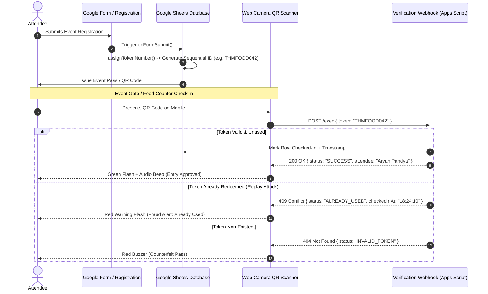

# 🎟️ QR Event Pass & Real-Time Token Authentication System

[](./web/)
[](./backend/Code.gs)
[](https://github.com/mebjas/html5-qrcode)
[](./docs/architecture.md)
[](./LICENSE)

An enterprise-ready, zero-infrastructure event check-in and access management system originally built and deployed for **The Hackers Meetup (THM) Surat**. Combines automated sequential token generation, real-time in-browser camera QR scanning, and single-use cryptographic anti-fraud validation.

---

## 🏛️ System Architecture & Event Lifecycle



---

## 🚀 Key Features

- **Automated Sequential Tokenization**: Generates non-colliding, standardized IDs (`THMFOOD001`, `THMFOOD002`, etc.) upon form submission with zero manual intervention.
- **Anti-Fraud Single-Use Protection**: Atomically marks tickets as consumed upon scanning, completely preventing duplicate entries, ticket sharing, or food pass reuse.
- **Client-Side Camera QR Scanner**: Built on `html5-qrcode` with live device camera switching, auto-torch toggle, and manual input fallback for unreadable passes.
- **Instant Audio & Haptic Feedback**: Positive frequency audio chime on successful entry, harsh buzzer on invalid/duplicate passes, and vibration alerts on mobile devices.
- **Zero-Cost Hosting Architecture**: Requires no paid servers or database subscriptions; runs on Google Workspace infrastructure with 99.9% uptime.

---

## 📂 Project Structure

```text
qr-ticket-auth-system/
├── README.md                      # Central architecture & setup guide
├── web/
│   ├── index.html                 # Cyberpunk-styled mobile-friendly check-in gate
│   ├── styles.css                 # Responsive HUD theme (Orbitron font, glowing statuses)
│   └── app.js                     # Camera scanning engine, feedback chimes, and API caller
├── backend/
│   ├── Code.gs                    # Complete Google Apps Script (Token Generator + REST API)
│   ├── appsscript.json            # Google Apps Script manifest
│   └── api-spec.md                # Full REST API specification
├── tests/
│   └── test_verification.py       # Automated test suite for token formatting and replay prevention
└── docs/
    ├── architecture.md            # Detailed security model and state transitions
    └── deployment-guide.md        # Step-by-step setup in Google Workspace
```

---

## 🛠️ Step-by-Step Setup Guide

### 1. Backend (Google Sheets & Apps Script)
1. Create a Google Sheet with columns:
   `Token ID | Timestamp | Full Name | Email | Checked-In | Check-In Time`
2. Open **Extensions > Apps Script** and paste [`backend/Code.gs`](./backend/Code.gs).
3. Set up an `On Form Submit` trigger for `assignFoodTokenNumber`.
4. Click **Deploy > New Deployment > Web App**:
   - Execute as: *Me*
   - Who has access: *Anyone*
5. Copy the generated Web App URL.

### 2. Frontend Gate Scanner
1. Open [`web/app.js`](./web/app.js) and update `API_ENDPOINT` with your Apps Script Web App URL.
2. Host [`web/`](./web/) on any static host (GitHub Pages, Netlify, or local device).
3. Point your smartphone or tablet camera at attendee QR codes for sub-second check-in.

---

## 👨‍💻 Author & Maintainer
**Aryan Pandya**  
- LinkedIn: [linkedin.com/in/aryanpandya](https://www.linkedin.com/in/aryanpandya)  
- Email: [pandyaaryanp348@gmail.com](mailto:pandyaaryanp348@gmail.com)  
- Portfolio: [github.com/Aryan-136](https://github.com/Aryan-136)
